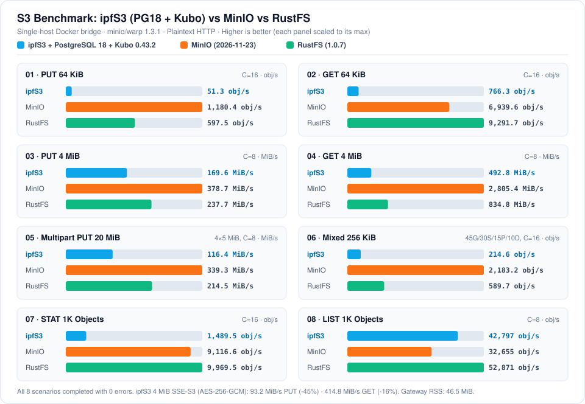

# ipfS3

[English](README.md) · [简体中文](README.zh-CN.md) · **Esperanto**

S3-kongrua objekto-konserveja kluzo subtenata de IPFS (Kubo). Alŝutu kaj administru dosierojn per normaj S3-iloj (`aws cli`, SDK-oj, rclone), kaj legu neĉifritajn objektojn rekte per IPFS laŭ ilia CID.

[](https://github.com/hugefiver/ipfS3/actions/workflows/ci.yml)
[](LICENSE.md)

## Trajtoj

- **Norma S3-API** — Siteloj (buckets), objektoj, amasa forigo, `ListObjects` v1/v2, plurparta alŝuto (Multipart Upload), versiado, etikedado, sitela CORS kaj SigV4 (inkluzive de antaŭsubskribitaj GET/PUT).
- **IPFS-denaska konservado** — Dosieroj konserviĝas en Kubo, dum metadatumoj loĝas en SQLite aŭ PostgreSQL. La S3-`ETag` de ĉiu objekto estas ĝia IPFS-CID, do neĉifritaj dosieroj rekte legeblas per `ipfs cat <cid>` aŭ ajna IPFS-HTTP-kluzo.
- **Laŭvola ĉifrado** — Neĉifrita defaŭlte; subtenas fluantan AES-256-GCM-ĉifradon per SSE-S3 (`AES256`) kaj SSE-C, inkluzive de ĉifritaj bajto-intervalaj (Range) legoj.
- **Alirkontrolo kaj limigoj** — Sitelaj ACL-oj (`private`, `authenticated-read`, `public-read`, `public-read-write`), lokaj reguloj laŭ uzanto/sitelo/anonimulo, eksterretaj provizoraj seanco-akreditaĵoj, sitelaj spackvotoj kaj peto-rapidlimoj.
- **Alidirektado al IPFS-kluzo** — Laŭvole respondu al `GetObject` per `307 Temporary Redirect` al IPFS-HTTP-kluzo laŭ sitelo, prefikso, dosiernomo, uzanto aŭ anonima peto. Klientoj povas superregi tion per `X-IPFS3-Download-Gateway: prefer | require | proxy`.
- **Fora nesinkrona pinglado (Pinning)** — Nesinkrona savkopiado al Pinata, Filebase, fora Kubo RPC aŭ IPFS Cluster kun daŭro-limoj per reguloj aŭ etikedoj (`ipfs-s3:pin`, `ipfs-s3:duration`, `ipfs-s3:retain-until`).
- **Vivciklo kaj tavoligo** — Eksvalidiĝo, purigo de nefinitaj plurpartaj alŝutoj, kaj transiro de `STANDARD` al `STANDARD_IA` sur laŭvola malvarma Kubo-nodo.
- **Importoj, ZIP-malpakado kaj dosierujaj CID-oj** — Nesinkronaj importoj per CID aŭ permeslistaj HTTPS-adresoj, servila ZIP-malpakado kun laŭvola UnixFS-dosieruja radiko, kaj laŭpeta UnixFS-dosieruja CID el `ListObjectsV2`.
- **Statika Pastebin** — Enkonstruita senservila retinterfaco en [`pastebin/`](pastebin/README.md) por publikigi tekston, dosierojn (kun samtempa plurparta alŝuto por grandaj dosieroj), klient-flanke ĉifritajn (E2EE) kundividojn kaj ZIP-dosierujojn.

## Rapida Komenco

### Docker Compose (loka / SQLite)

```bash
git clone https://github.com/hugefiver/ipfS3.git
cd ipfS3
cp .env.example .env
# Redaktu .env per viaj S3-ŝlosiloj kaj 64-heksuma ĉefŝlosilo
docker compose up -d --build
```

Por produkta uzo, vidu [`docker-compose.postgres.yml`](docker-compose.postgres.yml) (unu kluzo + PostgreSQL 18 + Kubo) aŭ [`docker-compose.multi-gateway.yml`](docker-compose.multi-gateway.yml) (du kluzoj malantaŭ Nginx kun komuna PostgreSQL kaj Kubo).

### Uzo kun AWS CLI

```bash
export AWS_ACCESS_KEY_ID=test
export AWS_SECRET_ACCESS_KEY=test
export AWS_DEFAULT_REGION=us-east-1

aws --endpoint-url http://localhost:9000 s3 mb s3://my-bucket
aws --endpoint-url http://localhost:9000 s3 cp hello.txt s3://my-bucket/hello.txt
aws --endpoint-url http://localhost:9000 s3 ls s3://my-bucket/
```

### Legado per IPFS

La `ETag` de objekto estas ĝia CID:

```bash
curl -I http://localhost:9000/my-bucket/hello.txt
# ETag: "bafybei..."

curl https://ipfs.io/ipfs/bafybei...
```

## Agordado

Agordoj ŝargiĝas el `config.toml` (aŭ `IPFS_S3_CONFIG`) kaj superregeblas per medivariabloj. Vidu [`config.example.toml`](config.example.toml) por la plena skemo.

| Medivariablo | Celo | Defaŭlto |
| --- | --- | --- |
| `IPFS_S3_CONFIG` | Vojo al TOML-agorddosiero | `config.toml` |
| `IPFS_S3_BIND` | Aŭskulta adreso por S3 HTTP | `0.0.0.0:9000` |
| `IPFS_S3_KUBO_RPC_URL` | Adreso de la ĉefa Kubo RPC | `http://127.0.0.1:5001` |
| `IPFS_S3_DATABASE_URL` | Datumbaza adreso (SQLite aŭ PostgreSQL) | `sqlite::memory:` |
| `IPFS_S3_ACCESS_KEY_ID` | Statika S3-alirŝlosilo | `test` |
| `IPFS_S3_SECRET_ACCESS_KEY` | Statika S3-sekreta ŝlosilo | `test` |
| `IPFS_S3_MASTER_KEY` | 64-signa heksuma ĉefŝlosilo (por SSE-S3 kaj SSE-C-fingrospuroj) | nur nuloj (nur por evoluigo) |
| `IPFS_S3_METRICS_BIND` | Laŭvola adreso por Prometheus `/metrics` | malŝaltita |
| `IPFS_S3_TRUST_PROXY_HEADERS` | Fidi klient-IP-kapojn de inversa prokurilo por rapidlimigo | `false` |

Sano-kontrolaj finpunktoj sur la S3-pordo:
- `GET /health` — proceza viveco (`200 OK`)
- `GET /ready` — datumbaza preteco (`200 READY` / `503 NOT READY`)

Komandliniaj helpiloj: `--config-explain` montras la efektivan sensekretan agordon; `--ready-probe` kontrolas pretecon de ruliĝanta kluzo.

## Ĉefaj Dezajnaj Kompromisoj

- **ETag = CID** — `ETag` estas la IPFS-CID anstataŭ MD5. Klientoj, kiuj strikte kontrolas MD5-ETag-ojn, eble bezonos malŝalti tiun kontrolon (vidu [klientan kongruecon](docs/client-compatibility.md)).
- **Metadatumoj en datumbazo, bajtoj en Kubo** — Forta S3-konsisteco venas el transakcioj en SQLite/PostgreSQL, dum Kubo konservas enhav-adresitajn blokojn.
- **S3-forigo ankoraŭ ne malpinglas el Kubo** — Pluraj ŝlosiloj aŭ versioj povas kundividi la saman CID, do forigo en S3 ankoraŭ ne forigas la pinglon en la ĉefa Kubo (planita en [`ROADMAP.md`](ROADMAP.md)).
- **Fiksa ĉefŝlosilo** — Konservu `IPFS_S3_MASTER_KEY` senŝanĝa dum la tuta vivdaŭro de ĉifritaj objektoj; rotacio de ĉefŝlosilo ne estas subtenata.
- **Fino de plurparta alŝuto** — Ĉe kompletigo, la partoj kunĉeniĝas kaj realiĝas kiel unu UnixFS-dosiero por ricevi unuopan radikan CID.

## Efikeco-Komparo

Mezurita sinsekve en unu-gastiga Docker-ponta reto per `minio/warp 1.3.1` (neĉifrita HTTP, SigV4, 0 eraroj en ĉiuj testoj), komparante **ipfS3** ([`docker-compose.postgres.yml`](docker-compose.postgres.yml): PostgreSQL 18.7 + Kubo 0.43.2) kun unu-noda **MinIO** (`RELEASE.2026-11-23`) kaj **RustFS** (`1.0.7`).



| Scenaro | ipfS3 (PG18 + Kubo) | MinIO | RustFS | ipfS3 kompare al MinIO / RustFS |
| --- | --- | --- | --- | --- |
| PUT 64 KiB (`C=16`) | 51.3 obj/s · 3.2 MiB/s (P50 325.2 ms) | 1,180.4 obj/s · 73.8 MiB/s (P50 12.6 ms) | 597.5 obj/s · 37.3 MiB/s (P50 25.6 ms) | 0.04× / 0.09× |
| GET 64 KiB (`C=16`) | 766.3 obj/s · 47.9 MiB/s (P50 8.2 ms) | 6,939.6 obj/s · 433.7 MiB/s (P50 2.0 ms) | 9,291.7 obj/s · 580.7 MiB/s (P50 1.6 ms) | 0.11× / 0.08× |
| PUT 4 MiB (`C=8`) | 42.4 obj/s · 169.6 MiB/s (P50 188.0 ms) | 94.7 obj/s · 378.7 MiB/s (P50 123.1 ms) | 59.4 obj/s · 237.7 MiB/s (P50 154.9 ms) | 0.45× / 0.71× |
| GET 4 MiB (`C=8`) | 123.2 obj/s · 492.8 MiB/s (P50 57.7 ms) | 701.3 obj/s · 2,805.4 MiB/s (P50 11.3 ms) | 208.7 obj/s · 834.8 MiB/s (P50 37.2 ms) | 0.18× / 0.59× |
| Multipart 20 MiB (`4×5 MiB, C=8`) | 23.3 parts/s · 116.4 MiB/s (P50 95.6 ms) | 67.9 parts/s · 339.3 MiB/s (P50 66.2 ms) | 42.9 parts/s · 214.5 MiB/s (P50 113.1 ms) | 0.34× / 0.54× |
| Mixed 256 KiB (`45G/30S/15P/10D, C=16`) | 214.6 obj/s · 32.1 MiB/s | 2,183.2 obj/s · 327.5 MiB/s | 589.7 obj/s · 88.4 MiB/s | 0.10× / 0.36× |
| STAT 1K objektoj (`C=16`) | 1,489.5 obj/s (P50 10.4 ms) | 9,116.6 obj/s (P50 1.5 ms) | 9,969.5 obj/s (P50 1.4 ms) | 0.16× / 0.15× |
| LIST 1K objektoj (`C=8`) | 42,797 obj/s (P50 23.0 ms) | 32,655 obj/s (P50 29.8 ms) | 52,871 obj/s (P50 18.8 ms) | **1.31×** / 0.81× |

Ĉefaj konkludoj:
- **Flua trafluo kaj malalta memoro** — Ĉe 4 MiB, ipfS3 atingas 71% de RustFS en PUT (`169.6 MiB/s`) kaj 59% en GET (`492.8 MiB/s`), dum la kluzo uzas nur ĉirkaŭ `46.5 MiB` da RSS-memoro. Kun SSE-S3 (`AES-256-GCM`), 4 MiB GET atingas `414.8 MiB/s` (-15.8%) kaj PUT `93.2 MiB/s` (-45.0%).
- **Rapida indeksita `LIST`** — Danke al B-arba indeksado en PostgreSQL 18, `LIST 1K` atingas `42,797 obj/s`, kio estas 31% pli rapida ol MinIO.
- **Superkosto de etaj skriboj** — Ĉiu `PUT` plenumas Kubo UnixFS-pecigon/haketon (`add`), sinkronan `pin/add` kaj PostgreSQL-transakciojn, do la skribrapido por etaj objektoj estas konsiderinde pli malalta ol ĉe rekte-diskaj konservejoj kiel MinIO kaj RustFS.

## Dokumentaro

- [Agorda referenco](config.example.toml) — plena komentita TOML-ekzemplo (alidirektado, rapidlimigo, pinglado, vivciklo, ZIP, importoj)
- [Lokaj reguloj kaj sitelaj ACL-oj](docs/local-policies.md) — sitelaj ACL-oj, prefiksaj/anonimaj reguloj, etikedaj kondiĉoj
- [Provizoraj seancoj](docs/local-sessions.md) — eksterretaj STS-stilaj seanco-akreditaĵoj
- [Sitelaj spackvotoj](docs/bucket-quota.md) — bajtolimoj laŭ sitelo
- [Datumbaza konservado kaj ĝisdatigoj](docs/database-storage.md) — agordo kaj skema migrado por SQLite/PostgreSQL
- [Dosieruja CID](docs/directory-cid.md) — kreado de UnixFS-dosieruja CID por S3-prefikso
- [Reakiro de fora pinglado](docs/pinning-recovery.md) — inspektado kaj reakiro de foraj pinglo-taskoj
- [Klienta kongrueco](docs/client-compatibility.md) — notoj por AWS CLI, SDK-oj kaj S3-klientoj
- [Statika Pastebin](pastebin/README.md) — retumila alŝut- kaj kundivid-interfaco kaj deplojo sur Cloudflare Pages
- [Vojmapo](ROADMAP.md) — planitaj funkcioj

## Evoluigado

Postulas Rust 1.92+ (eldono 2024).

```bash
cargo check
cargo test --lib --test integration
cargo run   # postulas lokan Kubo ĉe http://127.0.0.1:5001
```

Vidu [testan gvidilon](docs/testing.md) por testoj kun PostgreSQL, Docker kaj tutsistemaj provoj.

## Permesilo

Copyright (c) 2026 hugefiver. Licencita laŭ [AAAPL](LICENSE.md) (Anti American AI Public License).
