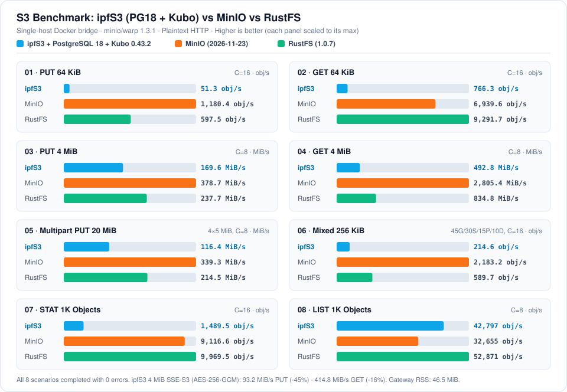

# ipfS3

**English** · [简体中文](README.zh-CN.md) · [Esperanto](README.eo.md)

An S3-compatible object storage gateway backed by IPFS (Kubo). Upload and manage files with standard S3 tools (`aws cli`, SDKs, rclone), and read plaintext objects directly over IPFS by CID.

[](https://github.com/hugefiver/ipfS3/actions/workflows/ci.yml)
[](LICENSE.md)

## Features

- **S3 API** — Buckets, objects, batch delete, `ListObjects` v1/v2, multipart upload, versioning, tagging, bucket CORS, and SigV4 (including presigned GET/PUT).
- **IPFS-native storage** — Files live in Kubo and metadata lives in SQLite or PostgreSQL. Every object's S3 `ETag` is its IPFS CID, so plaintext files work directly with `ipfs cat <cid>` or any IPFS HTTP gateway.
- **Optional encryption** — Plaintext by default; supports streaming AES-256-GCM encryption via SSE-S3 (`AES256`) and SSE-C, including encrypted byte-range reads.
- **Access control & limits** — Bucket ACLs (`private`, `authenticated-read`, `public-read`, `public-read-write`), local user/bucket/anonymous policies, offline temporary session credentials, bucket storage quotas, and per-caller rate limits.
- **IPFS gateway redirects** — Optionally answer `GetObject` with `307 Temporary Redirect` to an IPFS HTTP gateway, matched by bucket, prefix, filename glob, user, or anonymous caller. Clients can override with `X-IPFS3-Download-Gateway: prefer | require | proxy`.
- **Remote pinning** — Async backup pinning to Pinata, Filebase, remote Kubo RPC, or IPFS Cluster with per-policy or per-tag TTLs (`ipfs-s3:pin`, `ipfs-s3:duration`, `ipfs-s3:retain-until`).
- **Lifecycle & tiering** — Expiration, incomplete multipart cleanup, and `STANDARD` → `STANDARD_IA` transitions to an optional cold Kubo node.
- **Imports, ZIP extraction & directory CIDs** — Async CID or allowlisted HTTPS imports, server-side ZIP extraction with optional UnixFS directory roots, and on-demand UnixFS directory CIDs from `ListObjectsV2`.
- **Static Pastebin** — Includes a zero-backend static web UI in [`pastebin/`](pastebin/README.md) for publishing text, files, encrypted shares (client-side E2EE), and ZIP directories.

## Quick Start

### Docker Compose (local / SQLite)

```bash
git clone https://github.com/hugefiver/ipfS3.git
cd ipfS3
cp .env.example .env
# Edit .env with your S3 keys and 64-hex master key
docker compose up -d --build
```

For production deployments, use [`docker-compose.postgres.yml`](docker-compose.postgres.yml) (single gateway + PostgreSQL 18 + Kubo) or [`docker-compose.multi-gateway.yml`](docker-compose.multi-gateway.yml) (two gateways behind Nginx sharing PostgreSQL + Kubo).

### Use with AWS CLI

```bash
export AWS_ACCESS_KEY_ID=test
export AWS_SECRET_ACCESS_KEY=test
export AWS_DEFAULT_REGION=us-east-1

aws --endpoint-url http://localhost:9000 s3 mb s3://my-bucket
aws --endpoint-url http://localhost:9000 s3 cp hello.txt s3://my-bucket/hello.txt
aws --endpoint-url http://localhost:9000 s3 ls s3://my-bucket/
```

### Read via IPFS

The object's `ETag` is its CID:

```bash
curl -I http://localhost:9000/my-bucket/hello.txt
# ETag: "bafybei..."

curl https://ipfs.io/ipfs/bafybei...
```

## Configuration

Settings load from `config.toml` (or `IPFS_S3_CONFIG`) and can be overridden with environment variables. See [`config.example.toml`](config.example.toml) for the full schema.

| Environment Variable | Purpose | Default |
| --- | --- | --- |
| `IPFS_S3_CONFIG` | Path to TOML config file | `config.toml` |
| `IPFS_S3_BIND` | S3 HTTP listen address | `0.0.0.0:9000` |
| `IPFS_S3_KUBO_RPC_URL` | Primary Kubo RPC URL | `http://127.0.0.1:5001` |
| `IPFS_S3_DATABASE_URL` | SQLite or PostgreSQL URL | `sqlite::memory:` |
| `IPFS_S3_ACCESS_KEY_ID` | Static S3 access key | `test` |
| `IPFS_S3_SECRET_ACCESS_KEY` | Static S3 secret key | `test` |
| `IPFS_S3_MASTER_KEY` | 64-char hex key for SSE-S3 & SSE-C fingerprints | all zeros (dev only) |
| `IPFS_S3_METRICS_BIND` | Optional Prometheus `/metrics` address | disabled |
| `IPFS_S3_TRUST_PROXY_HEADERS` | Trust reverse-proxy client IP headers for rate limits | `false` |

Health endpoints on the S3 port:
- `GET /health` — process liveness (`200 OK`)
- `GET /ready` — database readiness (`200 READY` / `503 NOT READY`)

CLI helpers: `--config-explain` prints the effective non-secret config; `--ready-probe` checks a running gateway's readiness.

## Key Design Trade-offs

- **ETag = CID** — `ETag` is the IPFS CID rather than MD5. Clients that strictly check MD5 ETags may need that check disabled (see [client compatibility](docs/client-compatibility.md)).
- **Metadata in DB, bytes in Kubo** — Strong S3 consistency comes from SQLite/PostgreSQL transactions while Kubo stores content-addressed blocks.
- **S3 delete keeps Kubo pins** — Because multiple keys or versions can share a CID, deleting an S3 object does not unpin it from the primary Kubo node yet (planned in [`ROADMAP.md`](ROADMAP.md)).
- **Fixed master key** — Keep `IPFS_S3_MASTER_KEY` unchanged for the lifetime of any encrypted objects; key rotation is not implemented.
- **Multipart completion** — Parts are concatenated and re-added as one UnixFS file on completion so the final object gets a single root CID.

## Benchmarks

Measured sequentially on a single-host Docker bridge network with `minio/warp 1.3.1` (plaintext HTTP, SigV4, 0 errors across all runs), comparing **ipfS3** ([`docker-compose.postgres.yml`](docker-compose.postgres.yml): PostgreSQL 18.7 + Kubo 0.43.2) against single-node **MinIO** (`RELEASE.2026-11-23`) and **RustFS** (`1.0.7`).



| Scenario | ipfS3 (PG18 + Kubo) | MinIO | RustFS | ipfS3 vs MinIO / RustFS |
| --- | --- | --- | --- | --- |
| PUT 64 KiB (`C=16`) | 51.3 obj/s · 3.2 MiB/s (P50 325.2 ms) | 1,180.4 obj/s · 73.8 MiB/s (P50 12.6 ms) | 597.5 obj/s · 37.3 MiB/s (P50 25.6 ms) | 0.04× / 0.09× |
| GET 64 KiB (`C=16`) | 766.3 obj/s · 47.9 MiB/s (P50 8.2 ms) | 6,939.6 obj/s · 433.7 MiB/s (P50 2.0 ms) | 9,291.7 obj/s · 580.7 MiB/s (P50 1.6 ms) | 0.11× / 0.08× |
| PUT 4 MiB (`C=8`) | 42.4 obj/s · 169.6 MiB/s (P50 188.0 ms) | 94.7 obj/s · 378.7 MiB/s (P50 123.1 ms) | 59.4 obj/s · 237.7 MiB/s (P50 154.9 ms) | 0.45× / 0.71× |
| GET 4 MiB (`C=8`) | 123.2 obj/s · 492.8 MiB/s (P50 57.7 ms) | 701.3 obj/s · 2,805.4 MiB/s (P50 11.3 ms) | 208.7 obj/s · 834.8 MiB/s (P50 37.2 ms) | 0.18× / 0.59× |
| Multipart 20 MiB (`4×5 MiB, C=8`) | 23.3 parts/s · 116.4 MiB/s (P50 95.6 ms) | 67.9 parts/s · 339.3 MiB/s (P50 66.2 ms) | 42.9 parts/s · 214.5 MiB/s (P50 113.1 ms) | 0.34× / 0.54× |
| Mixed 256 KiB (`45G/30S/15P/10D, C=16`) | 214.6 obj/s · 32.1 MiB/s | 2,183.2 obj/s · 327.5 MiB/s | 589.7 obj/s · 88.4 MiB/s | 0.10× / 0.36× |
| STAT 1K objects (`C=16`) | 1,489.5 obj/s (P50 10.4 ms) | 9,116.6 obj/s (P50 1.5 ms) | 9,969.5 obj/s (P50 1.4 ms) | 0.16× / 0.15× |
| LIST 1K objects (`C=8`) | 42,797 obj/s (P50 23.0 ms) | 32,655 obj/s (P50 29.8 ms) | 52,871 obj/s (P50 18.8 ms) | **1.31×** / 0.81× |

Takeaways:
- **Streaming throughput & footprint** — At 4 MiB, ipfS3 reaches 71% of RustFS on PUT (`169.6 MiB/s`) and 59% on GET (`492.8 MiB/s`) while the gateway process stays around `46.5 MiB` RSS. Enabling SSE-S3 (`AES-256-GCM`) yields `414.8 MiB/s` on 4 MiB GET (-15.8%) and `93.2 MiB/s` on PUT (-45.0%).
- **Fast indexed `LIST`** — PostgreSQL 18 B-tree indexing puts `LIST 1K` at `42,797 obj/s`, outperforming MinIO by 31%.
- **Small-object write overhead** — Each `PUT` runs Kubo UnixFS chunking/hashing (`add`), synchronous `pin/add`, and PostgreSQL transactions, making small-object write IOPS much lower than direct-disk object stores.

## Documentation

- [Configuration reference](config.example.toml) — full annotated TOML config (redirects, rate limits, pinning, lifecycle, ZIP, imports)
- [Local policies & bucket ACLs](docs/local-policies.md) — bucket ACLs, prefix/anonymous rules, tag conditions
- [Temporary sessions](docs/local-sessions.md) — offline STS-style session credentials
- [Bucket storage quotas](docs/bucket-quota.md) — per-bucket logical byte limits
- [Database storage & upgrades](docs/database-storage.md) — SQLite/PostgreSQL setup and schema migrations
- [Directory CID](docs/directory-cid.md) — generating a UnixFS directory CID for an S3 prefix
- [Remote pinning recovery](docs/pinning-recovery.md) — inspecting and recovering remote pin tasks
- [Client compatibility](docs/client-compatibility.md) — notes for AWS CLI, SDKs, and S3 clients
- [Static Pastebin](pastebin/README.md) — browser upload/share frontend and Cloudflare Pages deployment
- [Roadmap](ROADMAP.md) — planned features

## Development

Requires Rust 1.92+ (edition 2024).

```bash
cargo check
cargo test --lib --test integration
cargo run   # requires Kubo at http://127.0.0.1:5001
```

See [testing guidance](docs/testing.md) for PostgreSQL, Docker, and end-to-end suites.

## License

Copyright (c) 2026 hugefiver. Licensed under the [AAAPL](LICENSE.md) (Anti American AI Public License).
