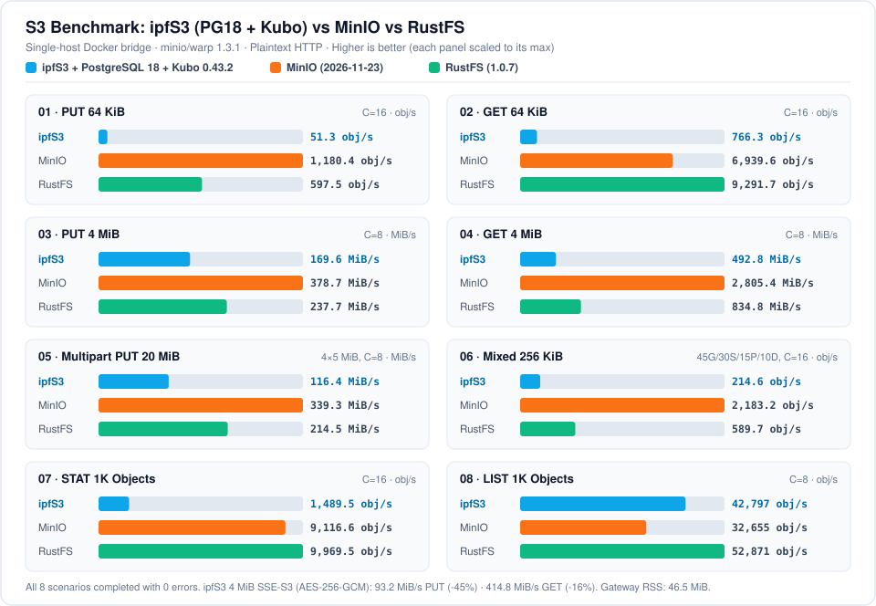

# ipfS3

[English](README.md) · **简体中文** · [Esperanto](README.eo.md)

基于 IPFS（Kubo）的 S3 兼容对象存储网关。你可以直接用标准 S3 工具（`aws cli`、各类 SDK、rclone）上传和管理文件，明文对象还能直接通过 CID 经 IPFS 访问。

[](https://github.com/hugefiver/ipfS3/actions/workflows/ci.yml)
[](LICENSE.md)

## 主要功能

- **标准 S3 接口** — 支持 Bucket/Object 增删改查、批量删除、`ListObjects` v1/v2、分片上传（Multipart Upload）、对象版本控制、对象标签、Bucket CORS，以及 SigV4 鉴权（含预签名 GET/PUT）。
- **IPFS 原生存储** — 文件内容存入 Kubo，元数据存在 SQLite 或 PostgreSQL。每个对象的 S3 `ETag` 就是它的 IPFS CID，明文文件可直接用 `ipfs cat <cid>` 或任意 IPFS HTTP 网关读取。
- **可选服务端加密** — 默认明文存储；支持流式 AES-256-GCM 的 SSE-S3（`AES256`）与 SSE-C，并支持加密对象的字节范围（Range）读取。
- **权限与限流** — 支持 Bucket ACL（`private`、`authenticated-read`、`public-read`、`public-read-write`）、按用户/Bucket/匿名请求的本地策略、离线临时会话凭证、按 Bucket 存储配额，以及按调用方限流。
- **下载重定向到 IPFS 网关** — 可按 Bucket、前缀、文件名通配符、用户或匿名请求，让 `GetObject` 返回 `307 Temporary Redirect` 指向指定 IPFS HTTP 网关；客户端可通过 `X-IPFS3-Download-Gateway: prefer | require | proxy` 覆盖行为。
- **远端异步 Pinning** — 支持异步备份到 Pinata、Filebase、远端 Kubo RPC 或 IPFS Cluster，按策略或对象标签（`ipfs-s3:pin`、`ipfs-s3:duration`、`ipfs-s3:retain-until`）管理保留时长。
- **生命周期与冷热分层** — 支持对象过期、未完成分片清理，以及从主 Kubo（`STANDARD`）到可选独立冷 Kubo（`STANDARD_IA`）的分层迁移。
- **导入、ZIP 解压与目录 CID** — 支持异步 CID 或白名单 HTTPS 导入、服务端 ZIP 解压（可选生成 UnixFS 目录根 CID），以及通过 `ListObjectsV2` 按前缀生成 UnixFS 目录 CID。
- **静态 Pastebin 前端** — 内置零后端静态站点 [`pastebin/`](pastebin/README.md)，支持文本/文件发布、大文件分片并发上传、浏览器端 E2EE 加密分享与 ZIP 目录发布。

## 快速开始

### Docker Compose（本地 / SQLite）

```bash
git clone https://github.com/hugefiver/ipfS3.git
cd ipfS3
cp .env.example .env
# 编辑 .env，填入你的 S3 密钥与 64 位十六进制 master key
docker compose up -d --build
```

生产环境可使用 [`docker-compose.postgres.yml`](docker-compose.postgres.yml)（单网关 + PostgreSQL 18 + Kubo）或 [`docker-compose.multi-gateway.yml`](docker-compose.multi-gateway.yml)（Nginx 后双网关共享 PostgreSQL 与 Kubo）。

### 使用 AWS CLI

```bash
export AWS_ACCESS_KEY_ID=test
export AWS_SECRET_ACCESS_KEY=test
export AWS_DEFAULT_REGION=us-east-1

aws --endpoint-url http://localhost:9000 s3 mb s3://my-bucket
aws --endpoint-url http://localhost:9000 s3 cp hello.txt s3://my-bucket/hello.txt
aws --endpoint-url http://localhost:9000 s3 ls s3://my-bucket/
```

### 通过 IPFS 直接访问

对象的 `ETag` 即为其 CID：

```bash
curl -I http://localhost:9000/my-bucket/hello.txt
# ETag: "bafybei..."

curl https://ipfs.io/ipfs/bafybei...
```

## 配置说明

配置优先从 `config.toml`（或 `IPFS_S3_CONFIG` 指定路径）加载，再由环境变量覆盖。完整配置项见 [`config.example.toml`](config.example.toml)。

| 环境变量 | 说明 | 默认值 |
| --- | --- | --- |
| `IPFS_S3_CONFIG` | TOML 配置文件路径 | `config.toml` |
| `IPFS_S3_BIND` | S3 HTTP 监听地址 | `0.0.0.0:9000` |
| `IPFS_S3_KUBO_RPC_URL` | 主 Kubo RPC 地址 | `http://127.0.0.1:5001` |
| `IPFS_S3_DATABASE_URL` | SQLite 或 PostgreSQL 连接串 | `sqlite::memory:` |
| `IPFS_S3_ACCESS_KEY_ID` | 静态 S3 Access Key | `test` |
| `IPFS_S3_SECRET_ACCESS_KEY` | 静态 S3 Secret Key | `test` |
| `IPFS_S3_MASTER_KEY` | 64 位十六进制主密钥（用于 SSE-S3 与 SSE-C 指纹） | 全零（仅限开发） |
| `IPFS_S3_METRICS_BIND` | 可选 Prometheus `/metrics` 监听地址 | 关闭 |
| `IPFS_S3_TRUST_PROXY_HEADERS` | 是否信任反代传递的客户端 IP 头用于限流 | `false` |

S3 端口自带健康检查接口：
- `GET /health` — 进程存活检查（`200 OK`）
- `GET /ready` — 数据库就绪检查（`200 READY` / `503 NOT READY`）

命令行辅助参数：`--config-explain` 输出脱敏后的生效配置；`--ready-probe` 检查运行中网关的就绪状态。

## 设计取舍

- **ETag = CID** — `ETag` 返回 IPFS CID 而非 MD5；严格校验 MD5 ETag 的客户端可能需要关闭该校验（见 [客户端兼容性](docs/client-compatibility.md)）。
- **元数据入库，文件块入 Kubo** — 用 SQLite/PostgreSQL 事务保证 S3 强一致性，用 Kubo 承载内容寻址存储。
- **S3 删除暂不自动 unpin 主 Kubo** — 多个 Key 或版本可能共享同一个 CID，当前删除对象不会回收主 Kubo 块（后续回收机制见 [`ROADMAP.md`](ROADMAP.md)）。
- **主密钥需保持不变** — 只要存在加密对象，就不要修改 `IPFS_S3_MASTER_KEY`（目前不支持主密钥轮换）。
- **分片合并重写入** — Multipart Upload 完成时，网关按顺序拼接各分片并作为单个 UnixFS 文件重新写入，以获得统一的根 CID。

## 性能基准

在同一宿主机 Docker 桥接网络下，使用 `minio/warp 1.3.1` 串行独占测得（明文 HTTP、SigV4 鉴权、全场景 0 错误），对比 **ipfS3**（[`docker-compose.postgres.yml`](docker-compose.postgres.yml)：PostgreSQL 18.7 + Kubo 0.43.2）与单节点 **MinIO**（`RELEASE.2026-11-23`）、**RustFS**（`1.0.7`）。



| 测试场景 | ipfS3 (PG18 + Kubo) | MinIO | RustFS | ipfS3 相对 MinIO / RustFS |
| --- | --- | --- | --- | --- |
| PUT 64 KiB（`C=16`） | 51.3 obj/s · 3.2 MiB/s（P50 325.2 ms） | 1,180.4 obj/s · 73.8 MiB/s（P50 12.6 ms） | 597.5 obj/s · 37.3 MiB/s（P50 25.6 ms） | 0.04× / 0.09× |
| GET 64 KiB（`C=16`） | 766.3 obj/s · 47.9 MiB/s（P50 8.2 ms） | 6,939.6 obj/s · 433.7 MiB/s（P50 2.0 ms） | 9,291.7 obj/s · 580.7 MiB/s（P50 1.6 ms） | 0.11× / 0.08× |
| PUT 4 MiB（`C=8`） | 42.4 obj/s · 169.6 MiB/s（P50 188.0 ms） | 94.7 obj/s · 378.7 MiB/s（P50 123.1 ms） | 59.4 obj/s · 237.7 MiB/s（P50 154.9 ms） | 0.45× / 0.71× |
| GET 4 MiB（`C=8`） | 123.2 obj/s · 492.8 MiB/s（P50 57.7 ms） | 701.3 obj/s · 2,805.4 MiB/s（P50 11.3 ms） | 208.7 obj/s · 834.8 MiB/s（P50 37.2 ms） | 0.18× / 0.59× |
| Multipart 20 MiB（`4×5 MiB, C=8`） | 23.3 parts/s · 116.4 MiB/s（P50 95.6 ms） | 67.9 parts/s · 339.3 MiB/s（P50 66.2 ms） | 42.9 parts/s · 214.5 MiB/s（P50 113.1 ms） | 0.34× / 0.54× |
| Mixed 256 KiB（`45G/30S/15P/10D, C=16`） | 214.6 obj/s · 32.1 MiB/s | 2,183.2 obj/s · 327.5 MiB/s | 589.7 obj/s · 88.4 MiB/s | 0.10× / 0.36× |
| STAT 1K 对象（`C=16`） | 1,489.5 obj/s（P50 10.4 ms） | 9,116.6 obj/s（P50 1.5 ms） | 9,969.5 obj/s（P50 1.4 ms） | 0.16× / 0.15× |
| LIST 1K 对象（`C=8`） | 42,797 obj/s（P50 23.0 ms） | 32,655 obj/s（P50 29.8 ms） | 52,871 obj/s（P50 18.8 ms） | **1.31×** / 0.81× |

关键结论：
- **中大对象流式吞吐与低内存** — 4 MiB 场景下，ipfS3 写入达到 RustFS 的 71%（`169.6 MiB/s`）、读取达到 59%（`492.8 MiB/s`），网关进程常驻内存仅约 `46.5 MiB`。开启 SSE-S3（`AES-256-GCM`）后，4 MiB 读取为 `414.8 MiB/s`（-15.8%），写入为 `93.2 MiB/s`（-45.0%）。
- **数据库索引加速 `LIST`** — 依托 PostgreSQL 18 B-Tree 索引，`LIST 1K` 达到 `42,797 obj/s`，反超 MinIO 31%。
- **小对象写入开销** — 每次 `PUT` 需经过 Kubo UnixFS 分块哈希（`add`）、同步 `pin/add` 落盘及 PostgreSQL 事务，因此高频小对象写入显著低于直写本地磁盘的 MinIO 与 RustFS。

## 相关文档

- [完整配置参考](config.example.toml) — 带注释的完整 TOML 示例（重定向、限流、Pinning、生命周期、ZIP、导入）
- [本地策略与 Bucket ACL](docs/local-policies.md) — Bucket ACL、前缀/匿名策略、标签条件
- [临时会话凭证](docs/local-sessions.md) — 离线 STS 风格临时凭证
- [Bucket 容量配额](docs/bucket-quota.md) — 按 Bucket 限制逻辑存储容量
- [数据库与升级](docs/database-storage.md) — SQLite/PostgreSQL 配置与 Schema 迁移
- [目录 CID](docs/directory-cid.md) — 为已有 S3 前缀生成 UnixFS 目录 CID
- [远端 Pin 运维与恢复](docs/pinning-recovery.md) — 排查与恢复远端 Pin 任务
- [客户端兼容性](docs/client-compatibility.md) — AWS CLI、SDK 等客户端注意事项
- [静态 Pastebin](pastebin/README.md) — 浏览器端上传分享界面与 Cloudflare Pages 部署
- [路线图](ROADMAP.md) — 后续计划功能

## 本地开发

需要 Rust 1.92+（edition 2024）。

```bash
cargo check
cargo test --lib --test integration
cargo run   # 需要本地 Kubo 运行在 http://127.0.0.1:5001
```

更多 PostgreSQL、Docker 及端到端测试说明见 [测试指南](docs/testing.md)。

## 开源协议

Copyright (c) 2026 hugefiver. 基于 [AAAPL](LICENSE.md)（Anti American AI Public License）许可发布。
